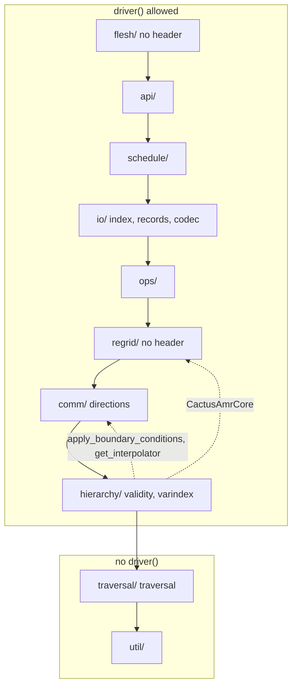
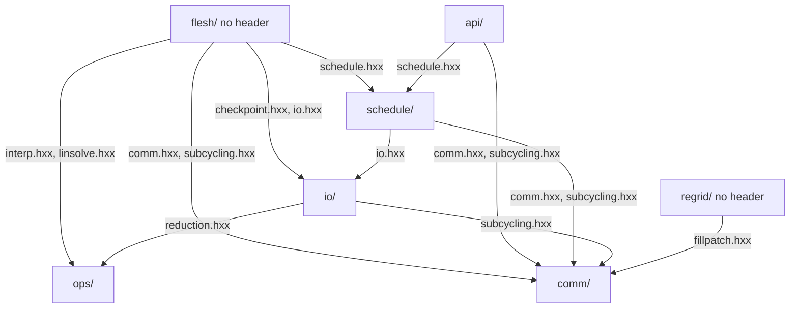
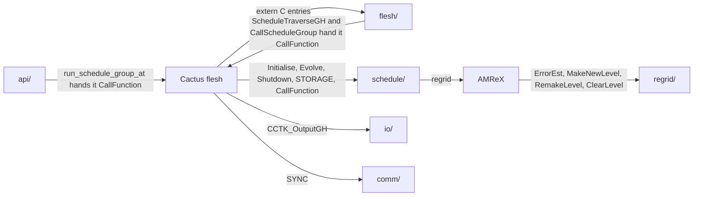

# CarpetX's internals

This is the map of `CarpetX/src/` for code that goes into CarpetX itself. A client thorn sees none of it: it reaches CarpetX only through `<carpetx.hxx>` and `<carpetx_rk.hxx>`, described in `agent_docs/carpetx-public-api.md`.

`CarpetX/src/` is ten directories, one per layer, and a file is in the layer of its directory. It includes `internal.hxx`, the public headers, and the headers of its own layer or a lower one, never a higher one, each spelled with its layer: `#include "hierarchy/driver.hxx"`, never `"driver.hxx"` or `"../hierarchy/driver.hxx"`. The two blocks below that open with a `%%` line are written by `python3 scripts/lint doc --write` from `scripts/lint/boundary/rules.py`, `scripts/lint/boundary/doc.py` and the `#include` lines of the tree, and `scripts/lint/boundary/test_rules.py` fails when they differ from what it writes; the third block is drawn by hand.

## The stack

A solid edge is "may include": a layer includes the layer below it and, through it, every layer further down, which the `layer` rule holds. The two boxes are the `door` rule: `driver()` is called in the upper box, never in the lower. A dashed edge is a declaration whose body is in the higher layer, the one way a call reaches up, at link time. A node names its layer, then the rules of "The check" whose home is in it. `regrid/` and `flesh/` have no header, so nothing includes them and `ops/` in fact includes `comm/` and below.

## The includes

What each layer includes today, read from its `#include` lines, with the headers on the edges. `util/`, `traversal/` and `hierarchy/` are not drawn: every layer reads them. An edge missing here is a coupling CarpetX does not have, which is what to weigh before adding an include.

## Who decides

The two graphs above point down. The calls that go up pass through an outsider, and that is where a layer high in the stack, the flesh or AMReX decides when a lower layer works. The flesh calls the overloads that `CarpetX_Startup` registered, so its edges land in the layers that define them. AMReX calls the callbacks in `regrid/` when `schedule/` asks it to regrid, and the calls `io/` makes on `CactusAmrCore` while recovering land there too, through the dashed edge of the stack. `flesh/` and `api/` hand `CallFunction` to the flesh's traversal, which calls it for every routine.

## Placing code

Put new code in the layer that owns what it works on; code that needs a header from a higher layer belongs in that layer or above it. When a value that a low layer reads is owned too high, the value moves down: the iteration a run recovered at is read by `comm/` to word one error, so it is a slot in `traversal/`, written once by `flesh/`, not a variable in `io/`, which reads the checkpoint. A lower layer may declare a function whose body needs a higher one; the higher layer defines it, the include stays downward, and the call reaches up only at link time, as the dashed edges of the stack show. `CactusAmrCore` is declared in `hierarchy/` because each `PatchData` owns one, and `regrid/` writes its callbacks; `apply_boundary_conditions` and `get_interpolator` are declared in `hierarchy/` because a group's data and tags select them, and `comm/` defines them beside the operators they use.

A new `.cxx` is a word of its layer's `make.code.defn` `SRCS`; the build stops on a `.cxx` it would not compile, and such a file is deleted, not kept. A new header includes `internal.hxx` first, and its guard spells its path: `CARPETX_CARPETX_HIERARCHY_DRIVER_HXX`. A function that other layers call is declared in a header of its layer; one that only its own layer calls, in a header named after the file that defines it; one that only its own file calls stays `static` or in an anonymous namespace. A new layer is an entry of `SUBDIRS` in the root `make.code.defn` and of `LAYERS` in `scripts/lint/boundary/rules.py`, at the same place in both; `python3 scripts/lint doc --write` then redraws the stack and the includes.

## The layers

### `util/`

Leaves that know nothing of the grid: `refuse` and the operation scope it reports under, the task manager, the timer, the MPI types, the logo, `typeprops` and `var_type`. A consumer that needs the C++ type behind a `var_type` passes `visit` a generic lambda, so that adding a value to the enum breaks that one switch and nothing else. A helper that both a low and a high layer want goes here only if it needs nothing above it; code that names the hierarchy, a level, a window or the scheduler does not belong here.

### `traversal/`

The scheduler's run-phase state, kept off the hierarchy: the active window, the tail bin, the recovery traversal, the routine being called and the iteration the run recovered at, each a slot with one writer and one reader. The window, tail-bin and recovery scopes refuse to nest; the routine scope leaves its routine set after the call, so that the flesh's SYNC after a routine can still name it. `schedule/` opens every scope, and `flesh/` records the recovered iteration once, before the hierarchy exists. A fact about the run's phase that `comm/`, `ops/` or `io/` must read without depending on `schedule/` is a new slot here; a fact about the grid belongs in `hierarchy/`.

### `hierarchy/`

The data model and the hierarchy's views of itself: `GHExt` and what it holds, the one pointer to it behind the door `driver()`, the group records, the group tags, the YAML emitters, the validity bookkeeping, the grid descriptors and cGH modes, and the loops over a window. A `GroupRecord` decodes the flesh's variable type once, when storage freezes, refusing a group whose type CarpetX does not store, so a consumer calls `visit` on the record's `var_type` instead of asking the flesh. A new field of `LevelData` or `GroupData` is declared in `driver.hxx`, initialised by its constructor, and written by its YAML emitter if the metadata output should show it. A function that reaches the hierarchy more than once binds `const GHExt &ext = driver();` once, `GHExt &` where it changes the hierarchy, and its lambdas capture `ext`; review holds this, the check does not. Moving data between levels, ranks or into ghost zones belongs to `comm/`, the bodies of the AMReX callbacks to `regrid/`, and the clocks and schedule bins to `schedule/`.

### `comm/`

Moving data between ranks, between levels, and into ghost and boundary zones: sync and restrict, fill-patch, the boundary conditions, the prolongation operators and the subcycling machinery. When to communicate is not decided here: `comm/` does what `schedule/` (a SYNC clause, the end-of-step restrict and reflux) and `api/` (the public communication operations) ask of it. The sync entry points take a window and a list of `gi_t`; only the flesh's SYNC overload receives the flesh's directions array, and discards it. A new prolongation operator is a change to this layer alone: its operator map declared in `prolongate_3d_rf2.hxx`, its instantiations in a new `prolongate_3d_rf2_impl_<name>.cxx`, and its name in `get_interpolator`.

### `regrid/`

The bodies of the AMReX callbacks of `CactusAmrCore`, the class `hierarchy/` declares and constructs one of per patch. It is where the callbacks are written, not a home for data-model code: what a level holds and how it is constructed belongs to `hierarchy/`, and `regrid/` tags cells for refinement and fills new and remade levels through `comm/`'s fill-patch. It has no header, and nothing includes it.

### `ops/`

Operations on grid data that other thorns ask for: interpolation, reductions, which the norm output uses too, and the Poisson solver. Their flesh entry points are in `flesh/`, which converts the flesh's arguments and calls in here.

### `io/`

Output, checkpoint and recovery, and the file reader's input. A writer or a checkpoint works on a `group_selection_t`, built from a parameter string or from a predicate over the records, so a group without storage is never selected and no writer filters storage itself. A group's facts come from its record, never from the flesh's group table, which the `records` rule holds, and a group, variable, time level, patch or level is named by its handle type, which the `index` rule holds; another layer joins either rule by appending itself to `RECORDS_LAYERS` or `INDEX_SOURCE_LAYERS` in `scripts/lint/boundary/rules.py` and converting what the rule then reports. The two checkpoint codecs translate between a `checkpoint_record_t` and a file and see nothing else, which the `codec` rule holds. When to output, checkpoint or recover is decided by the flesh's bins and by `schedule/`, which calls in here; `io/` does not include `schedule/`.

### `schedule/`

The driver's own loop: `Initialise`, `Evolve` and `Shutdown`, the clocks and the time step, the recovery sequence, the end-of-step restrict and reflux, the decoding of a routine's READS, WRITES and INVALIDATES clauses, `CallFunction`, which every scheduled routine runs through, and the STORAGE overloads. Its header declares only what `flesh/` registers and `api/` hands to the flesh's traversal. How a level is stored, synced or written is not decided here: the scheduler calls `hierarchy/`, `comm/` and `io/`.

### `api/`

The bodies of `carpetx.hxx` and `carpetx_rk.hxx`. A public operation names itself with `operation_scope_t`, so that its refusals say which call failed, checks its arguments, and calls the layer that owns the work; a new one is declared in `include/` and defined here. The layer sits above `schedule/` because `run_schedule_group_at` hands `CallFunction` to the flesh's traversal, as `flesh/` does.

### `flesh/`

The flesh edge: every `extern "C"` definition in CarpetX, in one file per way the flesh calls in. A new `PROVIDES FUNCTION` goes in `aliased.cxx`, a new scheduled function in `scheduled.cxx`, a new overload's registration in `CarpetX_Startup` in `startup.cxx`, and a compile-time check of a signature from another layer in `compile_checks.cxx`, which sits at the top so that it may include any of them. The layer owns none of the driver's data: an entry converts the flesh's arguments to CarpetX's types and calls the layer that does the work, and `SetupGH` and `CarpetX_Shutdown` create and destroy the hierarchy through `hierarchy/`. It has no header, and nothing includes it.

## The check

`python3 scripts/lint check --only boundary` runs the rules the stack's nodes name, with `layer`, `door`, `window`, `varindex` and `marker` in every layer and `index` in every layer's headers; `python3 scripts/lint check --help` prints what each holds, `scripts/lint/boundary/rules.py` defines them, and `agent_docs/carpetx-public-api.md` describes `include` and `marker`. The `boundary` check is one of the two checks of `scripts/lint`, beside `no-comments`: the edit hook in `.claude/settings.json` denies an Edit or Write that adds a finding of either, a Stop hook blocks the turn once if the branch has added one since `dev`, and the `Lint` workflow runs both with `--since` on every PR.
