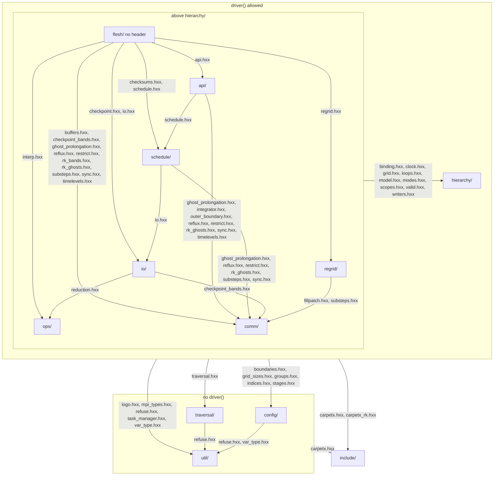
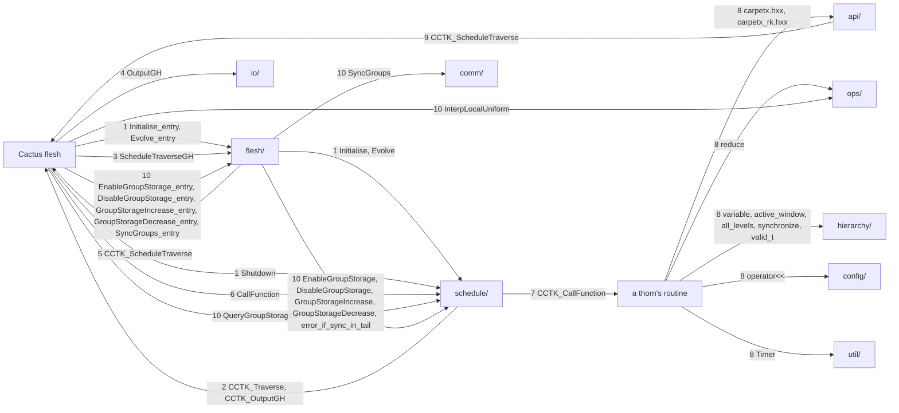
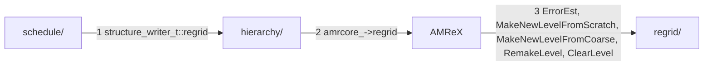

# CarpetX's internals

`python3 scripts/lint doc --write` writes this file. `python3 scripts/lint check --help` prints what every rule named below holds.

## The stack

- an arrow is an include a layer has today; the layer rule refuses one outside the table READS in scripts/lint/boundary/rules.py
- include/ is the public headers, not a layer

## One pass of the schedule

- a layer reaches a higher one only through an outsider, the Cactus flesh or AMReX

## One regrid

## What each layer owns

New code goes in the layer that owns what it works on, and a lower layer never decides for a higher one. A row under a layer is a file stem and the one concern it holds.

- `flesh/`: every `extern "C"`, and `hierarchy_writers_t`, the writers that own the hierarchy, which it lends to `schedule/` and `api/`. It owns no other data: an entry converts the flesh's arguments and calls the layer that does the work. Rules at home here: entry, ghost-only.
- `api/`: the bodies of the public headers. An operation names itself with `operation_scope_t`, checks its arguments, and calls the layer that owns the work. It keeps the writers it uses in one slot, and of the clock it changes only the stage time and step, for the length of one `run_at`. Rules at home here: ghost-only.
- `schedule/`: the driver's loop and clocks, and `CallFunction`, which every routine runs through, with its checksums. It opens the scopes of the run's phase and answers whether a sync may run in the open bin. How a level is stored, synced or written is decided below it. Its header declares only what `flesh/` registers or wraps, what `api/` hands to the flesh, and that one question, which `flesh/` and `api/` ask. A writer is an argument of each function that uses one, and none is kept between calls.
- `io/`: output, checkpoint, recovery and the file reader's input, and the format of the data model's metadata. When to do each is decided by the flesh's bins and by `schedule/`. Rules at home here: records, codec.
- `ops/`: operations on grid data that other thorns ask for. Their flesh entry points are in `flesh/`.
- `regrid/`: the bodies of the AMReX callbacks, never data-model code: what a level holds and how it is built belongs to `hierarchy/`.
- `comm/`: filling grid points whose values other grid points or the boundary conditions determine: ghosts from another rank or a coarser level, coarse cells from finer ones, and the outer boundary; with the operators it fills with and what it keeps on a level to do so. A stem either decides what is filled and records its validity, or applies and records nothing. It also owns three questions a fill must answer before it runs: which groups the integrator fills, where a level stands in its parent's step, and which groups have a flux register. It never decides when: `schedule/` and `api/` ask. A body names no `cGH` but the global one and changes nothing of the clock. Rules at home here: ghost-only, applies.
  - `sync`: the sync a routine or thorn asks for: ghosts from the same level and the coarser one, then the outer boundary
  - `restrict`: coarse cells from the finer level's
  - `ghost_prolongation`: which levels, groups and time levels are prolongated into, the validity that requires of the level it reads, and the validity it records
  - `outer_boundary`: which groups and time levels get the outer boundary, and the validity that records; the thorn routine it calls, and the refusal of a sync started from inside that call
  - `rk_ghosts`: filling coarse-fine ghosts between parent steps from the RK bands
  - `reflux`: flux registers: which groups have one, what accumulates in it, and correcting the coarse level from it
  - `fillpatch`: carrying data between two `MultiFab`s with an operator
  - `boundary_conditions`: applying a group's boundary conditions to one `MultiFab`
  - `prolongate_3d_rf2`: the prolongation operators, and the choice of one per group
  - `buffers`: what `comm/` keeps on a level, and its lifetime
  - `rk_bands`: what a level holds of its parent's RK step, and when it may be read
  - `checkpoint_bands`: the bands of a level a checkpoint carries, each under its tag
  - `timelevels`: which time levels a request covers
  - `group_selection`: which of the groups asked for an exchange acts on
  - `level_runs`: splitting a window into runs of levels a predicate treats alike
  - `level_pairs`: visiting each level of a window that has a child in it
  - `integrator`: what the registered integrator integrates, and in how many stages
  - `substeps`: where a level stands in its parent's step
- `hierarchy/`: the data model and what it cannot be built or written without. Nothing here only reads the model: a query belongs to the layer that owns its subject. Rules at home here: validity, binding, clock, varindex, model, grant, phase.
  - `model`: `GHExt`, its nested types, and the door `driver()`
  - `writers`: the writers of the hierarchy; `create_hierarchy` makes them once and returns them in `hierarchy_writers_t`, which owns the hierarchy
  - `clock`: the only place the model's run clock and the stage it shows are opened, and the only writes to the cGH clock fields: `cctkGH_clock` publishes every change to the flesh's cGH and to every copy of it; and the check that a cGH a scheduled function returns still shows it
  - `valid`: the validity state a time level stores
  - `scopes`: the only way to change that state: write, require and invalidate
  - `binding`: the only writes to the cGH pointer table
  - `modes`: which cGH a routine sees, and entering and leaving a mode
  - `loops`: visiting levels and tiles
  - `grid`: describing one tile to a kernel
  - `handles`: the bodies of the public handles, all in one place
- `config/`: what the run is configured with, and the index and stage types to say it in. Nothing here calls `driver()`.
  - `groups`: what a group was declared as: its kind and its tags
  - `boundaries`: the symmetries and default boundaries the parameters ask for
  - `grid_sizes`: the largest grid each level may have
  - `indices`: ranges over the public index types
  - `stages`: RK stages and the refinement of time
- `traversal/`: the run's phase, one slot per fact, each written only by a scope that `schedule/` opens. Its readers are `schedule/`, `flesh/` and the public `active_window()`; a lower layer is told what it needs of the phase in a call. A fact about the whole run or about the grid is not a slot here. Rules at home here: traversal.
- `util/`: leaves that know nothing of the grid. Nothing here names the hierarchy, a level, a window or the scheduler.
