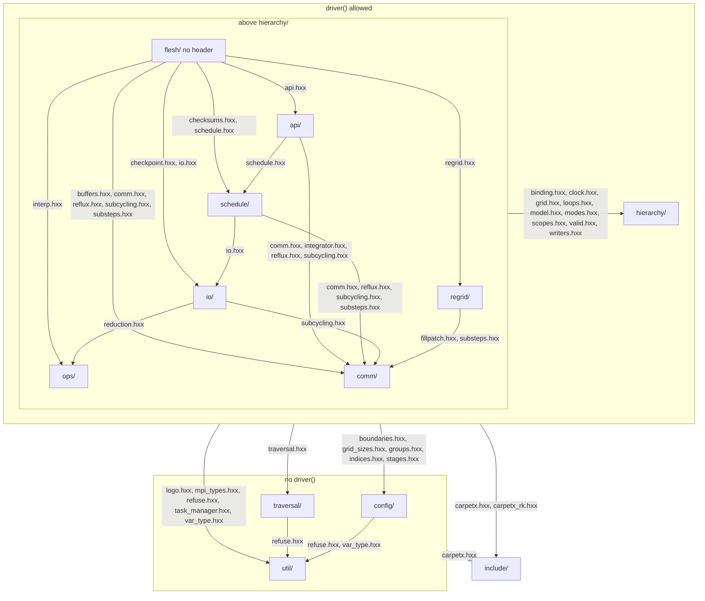
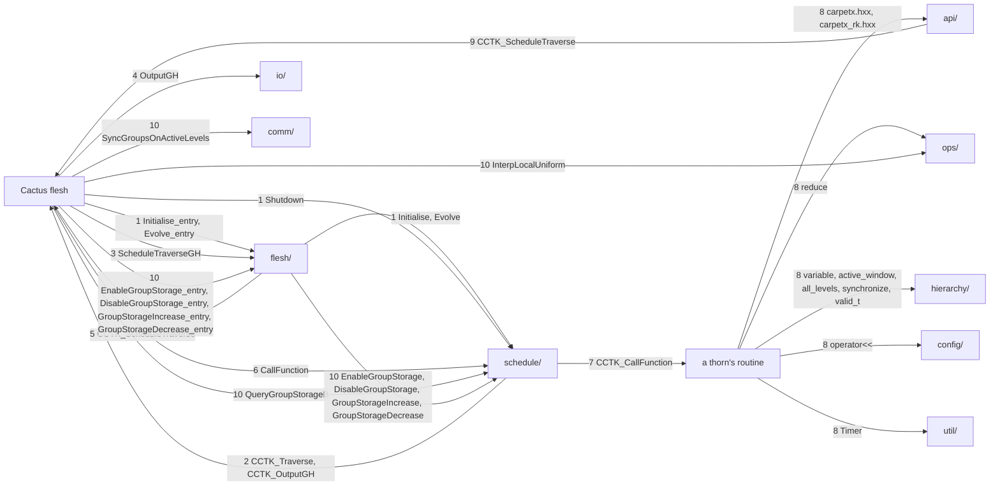
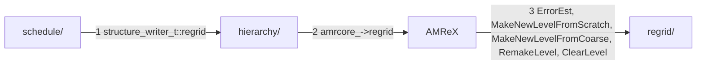

# CarpetX's internals

`python3 scripts/lint doc --write` writes this file from `scripts/lint/boundary/rules.py`, `scripts/lint/boundary/doc.py` and the code of `CarpetX/src/`, which it holds every picture to, and the edit hook refuses an edit to it. A client thorn sees none of this: it reaches CarpetX only through the headers `agent_docs/carpetx-public-api.md` describes. `python3 scripts/lint check --help` prints what every rule named below holds. The list under each picture is its key.

## The stack

- an arrow is an include a layer has today, with the headers on it, and a layer is drawn above what it includes; the layer rule holds the arrows to the table READS in scripts/lint/boundary/rules.py and refuses an include outside it
- an arrow from a box stands for the layers in it, and which of them reads which header is not drawn
- the outer boxes are the door rule: driver() is called in the upper box, never in the lower
- include/ is the public headers, not a layer
- a node names its layer, and no header where nothing can include it

## One pass of the schedule

- the numbered arrows are one pass of the schedule: the flesh starts the driver (1), the driver names a bin or asks for output (2), the flesh hands a bin to the driver's entry (3), the flesh hands output to io/ (4), the entry asks the flesh to walk the bin with CallFunction (5), the flesh calls CallFunction for each routine (6), CallFunction runs the routine (7), the routine may call the public headers, whose bodies are in api/ but for those drawn into another layer (8), api/ may ask the flesh to walk a schedule group, back to 6 (9), what a routine asks of the flesh, the flesh hands to the layer that owns the work (10)
- a layer reaches a higher one only through an outsider, the Cactus flesh or AMReX

## One regrid

- the numbered arrows are one regrid: schedule/ asks the hierarchy (1), the hierarchy asks AMReX (2), AMReX calls back into the layer that defines its callbacks (3)

## What each layer owns

New code goes in the layer that owns what it works on, and a lower layer never decides for a higher one. Each row says what its layer owns and what it never decides, then names the rules whose home is in it. A layer that the table STEMS in scripts/lint/boundary/rules.py lists has under it one row per file stem, a header and its source sharing the stem, that says the one concern the stem holds: a new stem needs a row, and a definition there is declared by the header of its stem.

- `flesh/`: every `extern "C"`, and `hierarchy_writers_t`, the writers that own the hierarchy, which it keeps in one slot from `create_hierarchy` to `CarpetX_Shutdown` and lends: as arguments to the entries of `schedule/` it wraps, and once to `api/` in `SetupGH`. It owns no other data: an entry converts the flesh's arguments and calls the layer that does the work. Rules at home here: entry, ghost-only.
- `api/`: the bodies of the public headers. An operation names itself with `operation_scope_t`, checks its arguments, and calls the layer that owns the work. A thorn calls in with no flesh entry in its path, so `api/` holds the writers it uses, `registry_writer_t`, `scratch_writer_t` and `stage_writer_t`, in one slot that `adopt_writers` fills and `return_writers` empties at shutdown. Of the clock it changes only the stage time and step every cGH shows in place of the run's, for the length of one `run_at`. Rules at home here: ghost-only.
- `schedule/`: the driver's loop and clocks, and `CallFunction`, which every routine runs through, with its checksums, which catch a write a routine did not declare. How a level is stored, synced or written is decided below it. Its header declares only what `flesh/` registers or wraps and what `api/` hands to the flesh. A writer is an argument of each function that uses one, and none is kept between calls; every change of the run's clock is an operation of the `clock_writer_t` it is passed, which shows it on every cGH.
- `io/`: output, checkpoint, recovery and the file reader's input, and the format of the data model's metadata. When to do each is decided by the flesh's bins and by `schedule/`. Rules at home here: records, codec.
- `ops/`: operations on grid data that other thorns ask for. Their flesh entry points are in `flesh/`.
- `regrid/`: the bodies of the AMReX callbacks, never data-model code: what a level holds and how it is built belongs to `hierarchy/`.
- `comm/`: moving data between ranks, between levels, and into ghost and boundary zones, and the queries about integrator stages, flux registers and substeps. It never decides when: `schedule/` and `api/` ask. A body names no `cGH` but the global one, takes the iteration from `current_iteration()` and the step from `driver().run_clock()`, and changes nothing of the clock. Rules at home here: directions, ghost-only.
- `hierarchy/`: the data model and what it cannot be built or written without. Nothing here only reads the model: a query belongs to the layer that owns its subject. Rules at home here: validity, binding, clock, varindex, model, grant.
  - `model`: `GHExt`, its nested types, and the door `driver()`
  - `writers`: the writers of the hierarchy; `create_hierarchy` makes them once and returns them in `hierarchy_writers_t`, which owns the hierarchy
  - `clock`: the only place the model's run clock and the stage it shows are opened, and the only writes to the cGH clock fields: `cctkGH_clock` publishes every change to the flesh's cGH and to every copy of it; and the check that a cGH a scheduled function returns still shows it
  - `valid`: the validity state a time level stores
  - `scopes`: the only way to change that state: write, require and invalidate
  - `binding`: the only writes to the cGH pointer table
  - `modes`: which cGH a routine sees, and entering and leaving a mode
  - `loops`: visiting levels and tiles
  - `grid`: describing one tile to a kernel
  - `handles`: the bodies of the public handles, all in one place
- `config/`: what the run is configured with, and the index and stage types to say it in. Nothing here calls `driver()`.
  - `groups`: what a group was declared as: its kind and its tags
  - `boundaries`: the symmetries and default boundaries the parameters ask for
  - `grid_sizes`: the largest grid each level may have
  - `indices`: ranges over the public index types
  - `stages`: RK stages and the refinement of time
- `traversal/`: the run's phase, one slot per fact with one writer. A fact about the phase that `comm/`, `ops/` or `io/` must read without depending on `schedule/` is a slot here; a fact about the grid is not. Rules at home here: traversal.
- `util/`: leaves that know nothing of the grid. Nothing here names the hierarchy, a level, a window or the scheduler.
