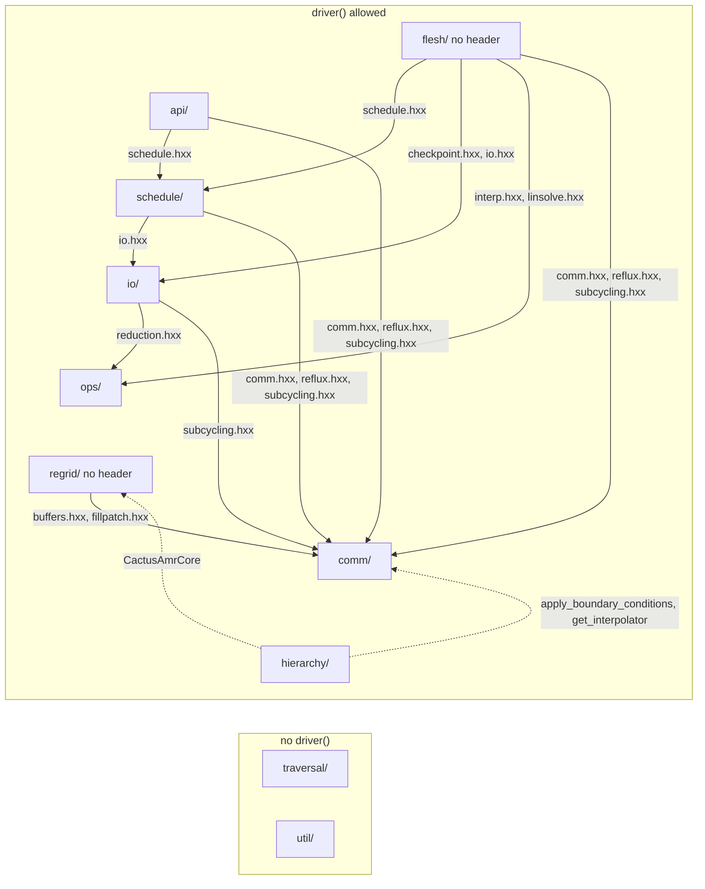
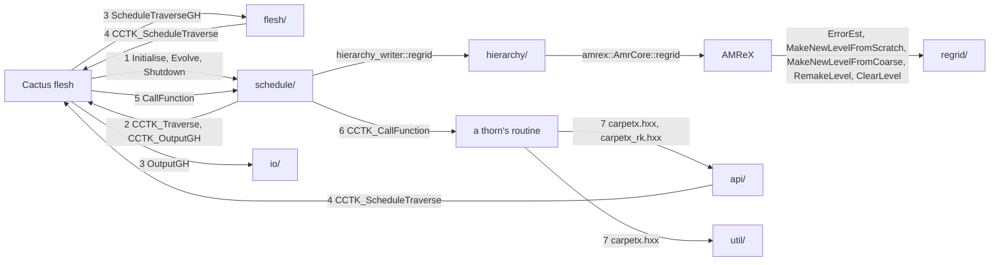

# CarpetX's internals

`python3 scripts/lint doc --write` writes this file from `scripts/lint/boundary/rules.py`, `scripts/lint/boundary/doc.py`, the `#include` lines and call sites of `CarpetX/src/` and the registrations in `CarpetX/src/flesh/startup.cxx`; `scripts/lint/boundary/test_rules.py` fails when the file differs from what it writes, and the edit hook refuses an edit to it. A client thorn sees none of this: it reaches CarpetX only through the headers `agent_docs/carpetx-public-api.md` describes. `python3 scripts/lint check --help` prints what every rule named below holds.

## The stack

## The loop

## Who the outsiders call

An outsider decides when a layer works: it calls one of these entries. Each row is a layer, who calls into it, and what they call.

| Layer | Caller | Entries |
| --- | --- | --- |
| `flesh/` | Cactus flesh | every extern "C" in aliased.cxx, scheduled.cxx, startup.cxx |
| `flesh/` | Cactus flesh | SetupGH, InitGH, ScheduleTraverseGH, MyProc, nProcs, Exit, Abort, Barrier, CarpetX_InterpGridArrays, ArrayGroupSizeB, GroupDynamicData |
| `api/` | a thorn | the functions of carpetx.hxx, carpetx_rk.hxx |
| `schedule/` | Cactus flesh | Initialise, Evolve, Shutdown, EnableGroupStorage, DisableGroupStorage, GroupStorageIncrease, GroupStorageDecrease, QueryGroupStorageB |
| `io/` | Cactus flesh | OutputGH |
| `ops/` | Cactus flesh | InterpLocalUniform |
| `regrid/` | AMReX | ErrorEst, MakeNewLevelFromScratch, MakeNewLevelFromCoarse, RemakeLevel, ClearLevel |
| `comm/` | Cactus flesh | SyncGroupsOnActiveLevels |
| `util/` | a thorn | the functions of carpetx.hxx |

## What each layer owns

New code goes in the layer that owns what it works on, and a lower layer never decides for a higher one. Each row says what its layer owns and what it never decides, then names the rules whose home is in it.

- `flesh/`: every `extern "C"`. It owns no data: an entry converts the flesh's arguments and calls the layer that does the work. Rules at home here: entry.
- `api/`: the bodies of the public headers. An operation names itself with `operation_scope_t`, checks its arguments, and calls the layer that owns the work.
- `schedule/`: the driver's loop and clocks, and `CallFunction`, which every routine runs through. How a level is stored, synced or written is decided below it, and its header declares only what `flesh/` registers and `api/` hands to the flesh.
- `io/`: output, checkpoint, recovery and the file reader's input. When to do each is decided by the flesh's bins and by `schedule/`. Rules at home here: records, codec.
- `ops/`: operations on grid data that other thorns ask for. Their flesh entry points are in `flesh/`.
- `regrid/`: the bodies of the AMReX callbacks, never data-model code: what a level holds and how it is built belongs to `hierarchy/`.
- `comm/`: moving data between ranks, between levels, and into ghost and boundary zones. It never decides when: `schedule/` and `api/` ask. A body names no `cGH` but the global one, and takes the iteration from `current_iteration()`. Rules at home here: directions.
- `hierarchy/`: the data model and the hierarchy's views of itself. What a checkpoint carries is a field of `LevelData` or `GroupData`; what `comm/` builds on a level is in the slot `buffers`; a change to the hierarchy that another layer needs is a member of `hierarchy_writer`. Rules at home here: validity, binding, varindex, model.
- `traversal/`: the run's phase, one slot per fact with one writer. A fact about the phase that `comm/`, `ops/` or `io/` must read without depending on `schedule/` is a slot here; a fact about the grid is not. Rules at home here: traversal.
- `util/`: leaves that know nothing of the grid. Nothing here names the hierarchy, a level, a window or the scheduler.
