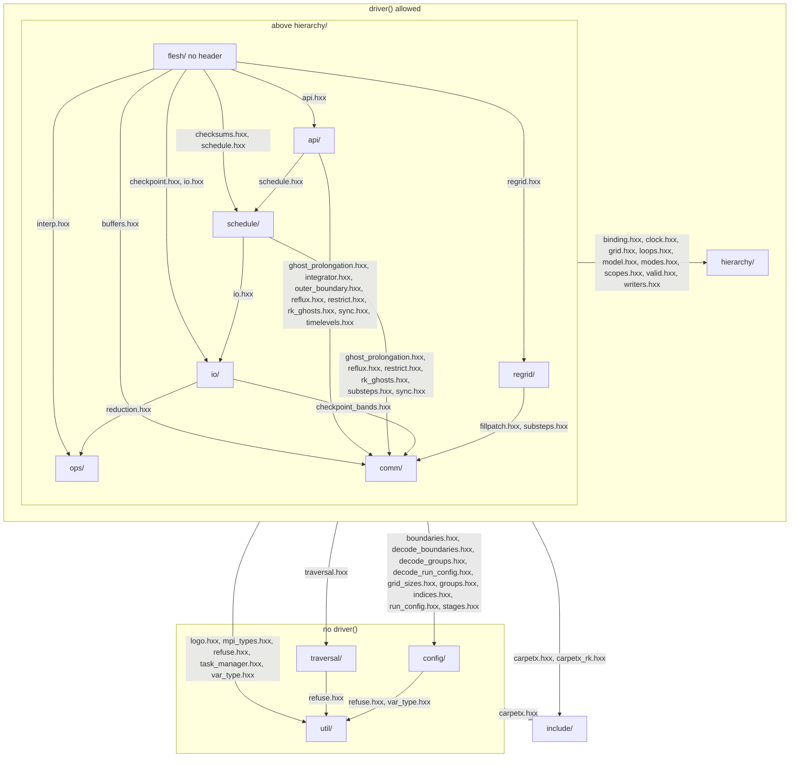
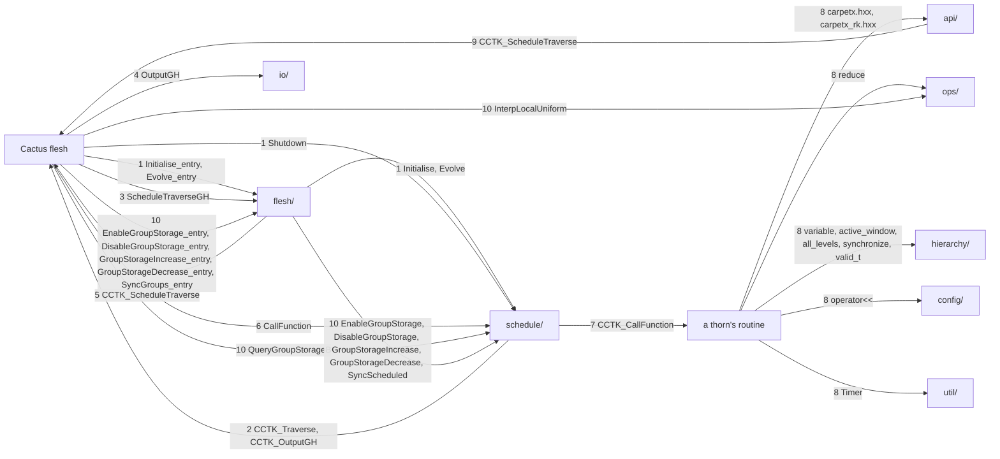
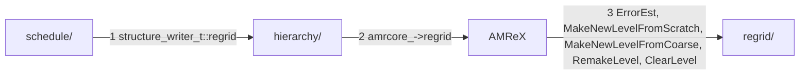

# CarpetX's internals

`python3 scripts/lint doc --write` writes this file. `python3 scripts/lint check --help` prints what every rule named below holds.

## The stack

- an arrow not into comm/ is an include a layer has today; the layer rule refuses one outside the table READS in scripts/lint/boundary/rules.py
- an arrow into comm/ is the interface that layer is given, the table GIVEN in scripts/lint/boundary/rules.py; the interface rule refuses an include outside it, and CarpetX/src/flesh/compile_checks.cxx, which checks the inside of comm/, adds nothing to an arrow
- include/ is the public headers, not a layer
- config/, hierarchy/, comm/, regrid/, io/, schedule/ and flesh/ read the run's parameters, and of config/ only the stems that decode them, decode_boundaries, decode_groups, decode_run_config, grid_sizes; every other file is told what it needs of them, as an argument or from driver(); the parameters rule refuses a read outside the tables PARAMETER_READERS and DECODES in scripts/lint/boundary/rules.py, and the decoder rule an include of a decoding stem's header outside them
- the model carries use_subcycling, do_reflux, max_num_levels, ghost_size, ghost_size_x, ghost_size_y, ghost_size_z, xmin, ymin, zmin, xmax, ymax, zmax, ncells_x, ncells_y, ncells_z, prolongate_per_group in its fixed part, read from driver().fixed in every layer, poison_undefined_values, poison_undefined_arrays, interpolation_order, regrid_error_threshold in its steered part, read from driver().steered() in every layer, and periodic, periodic_x, periodic_y, periodic_z, reflection_x, reflection_y, reflection_z, reflection_upper_x, reflection_upper_y, reflection_upper_z as each patch's symmetries, read from its PatchData; config/decode_run_config decodes the first two, and is included only from CarpetX/src/flesh/startup.cxx and CarpetX/src/schedule/callfunction.cxx, to fill the model: SetupGH decodes both parts once, and CallFunction re-takes the steered part on entry to every outermost scheduled routine, one no other routine runs through a schedule group, so that a steer reaches every layer at the next outermost routine and every site sees one value from that routine's entry to its end; config/decode_boundaries decodes the third, which a patch is handed when it is added; the carried rule refuses a scope that names one outside a decoding stem, the table CARRIED in scripts/lint/boundary/rules.py, and the snapshot rule an include of config/decode_run_config from any other file

## One pass of the schedule

- a layer reaches a higher one only through an outsider, the Cactus flesh or AMReX

## One regrid

## What each layer owns

New code goes in the layer that owns what it works on, and a lower layer never decides for a higher one. A row under a layer is a file stem and the one concern it holds.

- `flesh/`: every `extern "C"`, and `hierarchy_writers_t`, the writers that own the hierarchy, which it lends to `schedule/` and `api/`. It owns no other data: an entry converts the flesh's arguments and calls the layer that does the work. Rules at home here: entry.
- `api/`: the bodies of the public headers. An operation names itself with `operation_scope_t`, checks its arguments, and calls the layer that owns the work. It keeps the writers it uses in one slot, and of the clock it changes only the stage time and step, for the length of one `run_at`.
- `schedule/`: the driver's loop and clocks, and `CallFunction`, which every routine runs through, with its checksums; on entry to an outermost routine it alone re-takes the steered part of the run's configuration, through the `steer_writer_t` only it builds. It opens the scopes of the run's phase, and every sync of `comm/` runs through its `SyncRequested`, which refuses one the open bin does not allow and alone builds the `requested_sync_t` that `SyncGroups` takes; `SyncScheduled` is the flesh's sync, on the levels of the open traversal. How a level is stored, synced or written is decided below it. Its header declares only what `flesh/` registers or wraps, what `api/` hands to the flesh, and `SyncScheduled` and `SyncRequested`, which `flesh/` and `api/` call. A writer is an argument of each function that uses one, and none is kept between calls.
- `io/`: output, checkpoint, recovery and the file reader's input, and the format of the data model's metadata. When to do each is decided by the flesh's bins and by `schedule/`. It keeps one fact between two of the flesh's calls: the iteration of the checkpoint the parameters were recovered from, which the grid structure is then recovered from. Rules at home here: records, codec.
- `ops/`: operations on grid data that other thorns ask for. Their flesh entry points are in `flesh/`.
- `regrid/`: the bodies of the AMReX callbacks, never data-model code: what a level holds and how it is built belongs to `hierarchy/`.
- `comm/`: filling grid points whose values other grid points or the boundary conditions determine: ghosts from another rank or a coarser level, coarse cells from finer ones, and the outer boundary; with the operators it fills with and what it keeps on a level to do so. A stem either decides what is filled and records its validity, or applies and records nothing. It also owns three questions a fill must answer before it runs: which groups the integrator fills, where a level stands in its parent's step, and which groups have a flux register. Its `SyncGroups` takes a `requested_sync_t`, which only `SyncRequested` in `schedule/` builds, so a call from any other function does not compile, and its `SyncGhostsOnly` takes a `public_ghost_only_t`, which only the public `sync_ghosts_only` builds. What it keeps on a level is read const through `buffers_of`, and a buffer is opened only by the writer its `written_by` alias names. Its `restore_bands` takes a `checkpoint_read_t`, which only `read_record` in `io/` builds. It never decides when: `schedule/` and `api/` ask. A body names no `cGH` but the global one and changes nothing of the clock. Rules at home here: grant, applies, interface.
  - `sync`: the sync a routine or thorn asks for: ghosts from the same level and the coarser one, then the outer boundary. Interface for schedule/, api/.
  - `restrict`: coarse cells from the finer level's. Interface for schedule/, api/.
  - `ghost_prolongation`: which levels, groups and time levels are prolongated into, the validity that requires of the level it reads, and the validity it records. Interface for schedule/, api/.
  - `outer_boundary`: which groups and time levels get the outer boundary, and the validity that records; the thorn routine it calls, and the refusal of a sync started from inside that call. Interface for api/.
  - `rk_ghosts`: filling coarse-fine ghosts between parent steps from the RK bands. Interface for schedule/, api/.
  - `reflux`: flux registers: which groups have one, what accumulates in it, and correcting the coarse level from it. Interface for schedule/, api/.
  - `fillpatch`: carrying data between two `MultiFab`s with an operator. Interface for regrid/.
  - `boundary_conditions`: applying a group's boundary conditions to one `MultiFab`. Inside.
  - `prolongate_3d_rf2`: the prolongation operators, and the choice of one per group. Inside.
  - `buffers`: what `comm/` keeps on a level and its lifetime, and the one writer of each buffer: `flux_register_writer_t` of the flux registers and their scratch, `rk_source_writer_t` of the RK sources, `rk_fill_patch_writer_t` of the RK fill patches; the cell volume has none. Interface for flesh/.
  - `rk_bands`: what a level holds of its parent's RK step and when it may be read, and the two patches the RK fill works in. Inside.
  - `checkpoint_bands`: the bands of a level a checkpoint carries, each under its tag. Interface for io/.
  - `timelevels`: which time levels a request covers. Interface for api/.
  - `group_selection`: which of the groups asked for an exchange acts on. Inside.
  - `level_runs`: splitting a window into runs of levels a predicate treats alike. Inside.
  - `level_pairs`: visiting each level of a window that has a child in it. Inside.
  - `integrator`: what the registered integrator integrates, and in how many stages. Interface for api/.
  - `substeps`: where a level stands in its parent's step. Interface for regrid/, schedule/.
- `hierarchy/`: the data model and what it cannot be built or written without. Nothing here only reads the model: a query belongs to the layer that owns its subject. Rules at home here: validity, binding, clock, varindex, model, grant, cast, phase.
  - `model`: `GHExt`, its nested types, and the door `driver()`; and `steer_writer_t`, the key only `CallFunction` builds, which re-takes the steered part of the run's configuration
  - `writers`: the writers of the hierarchy; `create_hierarchy` makes them once and returns them in `hierarchy_writers_t`, which owns the hierarchy
  - `clock`: the only place the model's run clock and the stage it shows are opened, and the only writes to the cGH clock fields: `cctkGH_clock` publishes every change to the flesh's cGH and to every copy of it; and the check that a cGH a scheduled function returns still shows it
  - `valid`: the validity state a time level stores
  - `scopes`: the only way to change that state: write, require and invalidate
  - `binding`: the only writes to the cGH pointer table
  - `modes`: which cGH a routine sees, and entering and leaving a mode
  - `loops`: visiting levels and tiles
  - `grid`: describing one tile to a kernel
  - `handles`: the bodies of the public handles, all in one place
- `config/`: what the run is configured with, and the index and stage types to say it in. Nothing here calls `driver()`.
  - `groups`: what a group was declared as: its kind and its tags
  - `decode_groups`: the one decoding of a group's declaration from its tags and the parameters, which the hierarchy is handed when storage is frozen
  - `boundaries`: `boundary_t`, the condition a face of the domain is given, and `faces_t`, one value per face
  - `decode_boundaries`: the symmetries and default boundaries the parameters ask for
  - `grid_sizes`: the largest grid each level may have
  - `run_config`: what the model carries of the run's configuration: `fixed_config_t`, the part fixed for the run, and `steered_config_t`, the part a steer changes
  - `decode_run_config`: the one decoding of what the model carries of the run's configuration, which only the files that fill the model call
  - `indices`: ranges over the public index types
  - `stages`: RK stages and the refinement of time
- `traversal/`: the run's phase, one slot per fact, each written only by a scope that `schedule/` opens. Its readers are `schedule/` and the public `active_window()`; a lower layer is told what it needs of the phase in a call. A fact about the whole run or about the grid is not a slot here. Rules at home here: traversal.
- `util/`: leaves that know nothing of the grid. Nothing here names the hierarchy, a level, a window or the scheduler.
