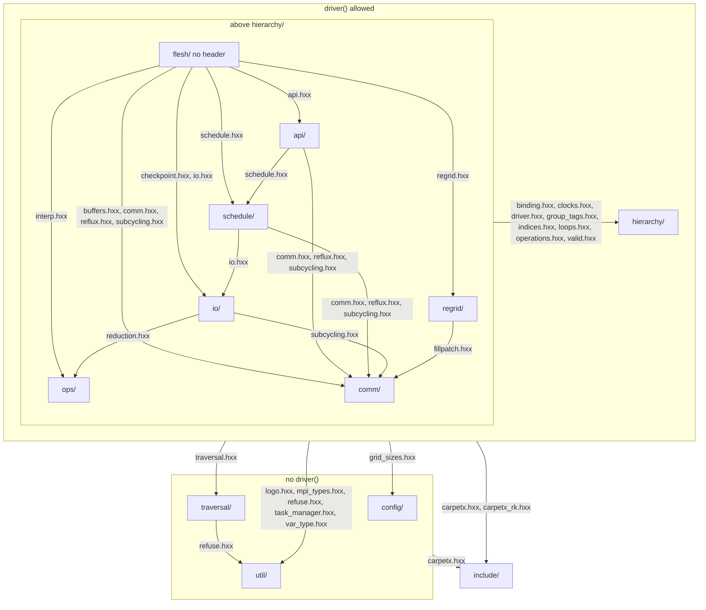
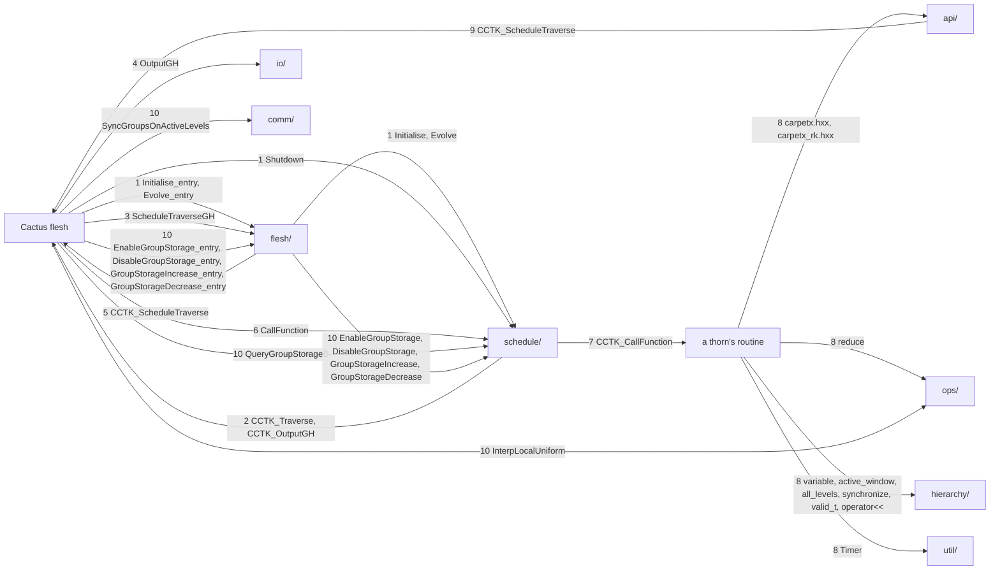
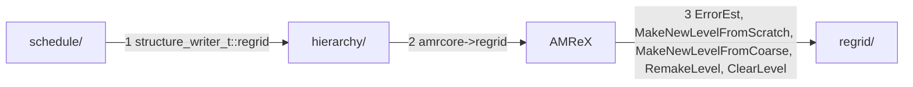

# CarpetX's internals

`python3 scripts/lint doc --write` writes this file from `scripts/lint/boundary/rules.py`, `scripts/lint/boundary/doc.py`, the `#include` lines of `CarpetX/src/` and the rows of doc.py it holds to the code, each a registration in `CarpetX/src/flesh/startup.cxx`, a call or a body; `scripts/lint/boundary/test_rules.py` fails when the file differs from what it writes, and the edit hook refuses an edit to it. A client thorn sees none of this: it reaches CarpetX only through the headers `agent_docs/carpetx-public-api.md` describes. `python3 scripts/lint check --help` prints what every rule named below holds. The list under each picture is its key.

## The stack

- the layer rule holds what each layer reads, the table READS in scripts/lint/boundary/rules.py: a file includes only its own layer or one its layer reads, and util/ reads nothing; traversal/ reads util/; config/ reads nothing; hierarchy/ reads util/, traversal/; comm/ reads util/, traversal/, hierarchy/; regrid/ reads hierarchy/, comm/; ops/ reads util/, traversal/, hierarchy/; io/ reads util/, traversal/, hierarchy/, comm/, ops/; schedule/ reads traversal/, config/, hierarchy/, comm/, io/; api/ reads util/, hierarchy/, comm/, schedule/; flesh/ reads util/, traversal/, config/, hierarchy/, comm/, regrid/, ops/, io/, schedule/, api/
- a layer reads only layers before it in that list, an include outside the table is refused, and an entry no file of the layer includes fails the tests, so the table holds exactly the layer-to-layer includes the tree has today
- a solid arrow is an include a layer has today, read from its #include lines, with the headers on it, and a layer is drawn above what it includes
- an arrow from a box stands for the layers in it: its label is every header one of them reads from the target, and which layer reads which is not drawn; the inner box, every layer above hierarchy/, is there for the arrow into hierarchy/
- the outer boxes are the door rule: driver() is called in the upper box, never in the lower
- include/ is the public headers, carpetx.hxx, carpetx_rk.hxx, not a layer: a thorn reads nothing else of CarpetX, and agent_docs/carpetx-public-api.md describes them
- a node names its layer, and no header where nothing can include it

## One pass of the schedule

- the numbered arrows are one pass of the schedule: the flesh starts the driver (1), the driver names a bin or asks for output (2), the flesh hands a bin to the driver's entry (3), the flesh hands output to io/ (4), the entry asks the flesh to walk the bin with CallFunction (5), the flesh calls CallFunction for each routine (6), CallFunction runs the routine (7), the routine may call the public headers, whose bodies are in api/ but for those the table names (8), api/ may ask the flesh to walk a schedule group, back to 6 (9), what a routine asks of the flesh, the flesh hands to the layer that owns the work (10)
- a layer reaches a higher one only through an outsider, the Cactus flesh or AMReX

## One regrid

- the numbered arrows are one regrid: the driver asks the hierarchy (1), the hierarchy asks AMReX (2), AMReX calls back into the layer that defines its callbacks (3)
- the table below lists every entry an outsider calls

## Who the outsiders call

An outsider decides when a layer works: it calls one of these entries. Each row is a layer, who calls into it, and what they call.

| Layer | Caller | Entries |
| --- | --- | --- |
| `flesh/` | Cactus flesh | every extern "C" in aliased.cxx, scheduled.cxx, startup.cxx |
| `flesh/` | Cactus flesh | SetupGH, InitGH, ScheduleTraverseGH, Initialise_entry, Evolve_entry, MyProc, nProcs, Exit, Abort, Barrier, EnableGroupStorage_entry, DisableGroupStorage_entry, GroupStorageIncrease_entry, GroupStorageDecrease_entry, CarpetX_InterpGridArrays, ArrayGroupSizeB, GroupDynamicData |
| `api/` | a thorn | every function of carpetx.hxx, carpetx_rk.hxx not named in a row below |
| `schedule/` | Cactus flesh | Shutdown, QueryGroupStorageB |
| `io/` | Cactus flesh | OutputGH |
| `ops/` | Cactus flesh | InterpLocalUniform |
| `ops/` | a thorn | reduce |
| `regrid/` | AMReX | ErrorEst, MakeNewLevelFromScratch, MakeNewLevelFromCoarse, RemakeLevel, ClearLevel |
| `comm/` | Cactus flesh | SyncGroupsOnActiveLevels |
| `hierarchy/` | a thorn | variable, active_window, all_levels, synchronize, valid_t, operator<< |
| `util/` | a thorn | Timer |

## What each layer owns

New code goes in the layer that owns what it works on, and a lower layer never decides for a higher one. Each row says what its layer owns and what it never decides, then names the rules whose home is in it. Under a layer that the table STEMS in scripts/lint/boundary/rules.py lists is one row per file stem, a header and its source sharing the stem, that says the one concern the stem holds: a stem with no row or a row with no stem fails the generator, `scripts/lint symbols` refuses a definition there that the header of its stem does not name, and the tests refuse a source there with no header and an include of one of its headers that uses no name the header declares.

- `flesh/`: every `extern "C"`, and the four writers of the hierarchy that `create_hierarchy` returns, `hierarchy_writers_t`, which it keeps in one slot and lends: as arguments to the entries of `schedule/` it wraps, and once to `api/` in `SetupGH`. The set owns the hierarchy, so `CarpetX_Shutdown` destroys the hierarchy by emptying the slot, after `api/` has returned its two. It never holds `level_writer_t`: the structure writer lends that to the AMReX core in `regrid/` when `InitGH` adds a patch. It owns no other data: an entry converts the flesh's arguments and calls the layer that does the work. Rules at home here: entry, ghost-only.
- `api/`: the bodies of the public headers. An operation names itself with `operation_scope_t`, checks its arguments, and calls the layer that owns the work. A thorn calls in with no flesh entry in its path, so `api/` holds the two writers it uses, `registry_writer_t` and `scratch_writer_t`, in its one slot: `adopt_writers` fills it and refuses while it is full, `return_writers` empties it at shutdown, and `registry_writer` and `scratch_writer` refuse while it is empty. Rules at home here: ghost-only.
- `schedule/`: the driver's loop and clocks, and `CallFunction`, which every routine runs through. How a level is stored, synced or written is decided below it. Its header declares only what `flesh/` registers, what `flesh/` wraps to lend a writer, which is `Initialise`, `Evolve` and the four storage functions that record storage, and what `api/` hands to the flesh. A writer is an argument of each function that uses one, and none is kept between calls.
- `io/`: output, checkpoint, recovery and the file reader's input. When to do each is decided by the flesh's bins and by `schedule/`. Rules at home here: records, codec.
- `ops/`: operations on grid data that other thorns ask for. Their flesh entry points are in `flesh/`.
- `regrid/`: the bodies of the AMReX callbacks, never data-model code: what a level holds and how it is built belongs to `hierarchy/`.
- `comm/`: moving data between ranks, between levels, and into ghost and boundary zones. It never decides when: `schedule/` and `api/` ask. A body names no `cGH` but the global one, and takes the iteration from `current_iteration()`. Rules at home here: directions, ghost-only.
- `hierarchy/`: the data model and the hierarchy's views of itself. What a checkpoint carries is a field of `LevelData` or `GroupData`, or an RK band, which `comm/` owns and hands out through `checkpoint_bands` and `restore_bands`; what `comm/` builds on a level is in the slot `buffers`; a change to the hierarchy that another layer needs is a member of one of five writers, by what it writes: `clock_writer_t`, `structure_writer_t`, `level_writer_t`, `registry_writer_t` or `scratch_writer_t`. A writer has no public constructor, copy or move, and writes through the `GHExt &` it holds, so no member can be static. `create_hierarchy` makes them once and returns four in `hierarchy_writers_t`, which owns the hierarchy: destroying it is the only way to destroy the hierarchy, and `hierarchy/` keeps none, only the pointer `driver()` reads; the level writer is a private member of the structure writer, which lends it to the AMReX core of each patch it adds and builds a recovered level through it. Rules at home here: validity, binding, varindex, model.
- `config/`: what the run is configured with, and the index and stage types to say it in. Nothing here calls `driver()`.
  - `grid_sizes`: the largest grid each level may have
- `traversal/`: the run's phase, one slot per fact with one writer. A fact about the phase that `comm/`, `ops/` or `io/` must read without depending on `schedule/` is a slot here; a fact about the grid is not. Rules at home here: traversal.
- `util/`: leaves that know nothing of the grid. Nothing here names the hierarchy, a level, a window or the scheduler.
